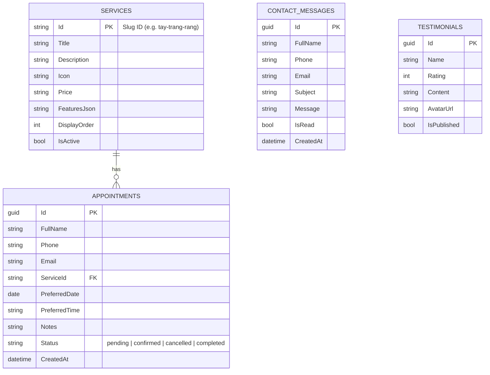

# 🔌 API Specification & Database Schema (Frontend ↔ ASP.NET Core 9)

Tài liệu định nghĩa hợp đồng giao tiếp (API Contract) giữa ứng dụng Frontend Next.js và Backend C# ASP.NET Core 9 Web API.

---

## 1. Cấu Hình Kết Nối Từ Frontend

- **File Client:** [`src/lib/api/client.ts`](../src/lib/api/client.ts)
- **Biến môi trường:**
  ```env
  NEXT_PUBLIC_API_URL=https://localhost:7001/api
  ```
- **Cơ chế hoạt động:**
  - `apiClient.get<T>(endpoint)`
  - `apiClient.post<T>(endpoint, data)`
  - `apiClient.put<T>(endpoint, data)`
  - `apiClient.delete<T>(endpoint)`
- **Lưu ý quan trọng:** Khi Backend chưa chạy (môi trường preview tĩnh), các form `BookingFormSection` và `ContactFormMap` bắt lỗi `try / catch` an toàn và vẫn hiển thị hộp thoại xác nhận trải nghiệm người dùng.

---

## 2. TypeScript Data Models (`src/types/index.ts`)

```ts
export interface Service {
  id: string;
  title: string;
  description: string;
  icon: string;
  price: string;
  features: string[];
  slug: string;
}

export interface Appointment {
  id?: string;
  fullName: string;
  phone: string;
  email?: string;
  serviceId: string;
  preferredDate: string; // YYYY-MM-DD
  preferredTime: string; // HH:mm (VD: "09:00")
  notes?: string;
  status?: "pending" | "confirmed" | "cancelled" | "completed";
  createdAt?: string;
}

export interface ContactMessage {
  id?: string;
  fullName: string;
  email: string;
  phone?: string;
  subject: string;
  message: string;
  createdAt?: string;
}

export interface Testimonial {
  id: string;
  name: string;
  rating: number;
  content: string;
  avatarUrl?: string;
}
```

---

## 3. Danh Sách REST API Endpoints

### 3.1. Dịch vụ nha khoa (`Services`)
- **`GET /api/services`**
  - **Mô tả:** Lấy danh sách toàn bộ dịch vụ nha khoa đang hoạt động.
  - **Response `200 OK`:** `Service[]`
- **`GET /api/services/{slug}`**
  - **Mô tả:** Lấy thông tin chi tiết 1 dịch vụ theo `id`/`slug` (VD: `tay-trang-rang`, `nieng-rang`, `cay-ghep-implant`, `boc-rang-su`, `nho-rang-khon`, `dieu-tri-tuy`, `dieu-tri-nuou`, `nha-khoa-tre-em`).

### 3.2. Đặt lịch hẹn (`Appointments`)
- **`POST /api/appointments`**
  - **Được gọi từ:** [`src/components/pages/booking/BookingFormSection.tsx`](../src/components/pages/booking/BookingFormSection.tsx)
  - **Request Body:**
    ```json
    {
      "fullName": "Nguyễn Văn A",
      "phone": "0941829179",
      "email": "khachhang@gmail.com",
      "serviceId": "tay-trang-rang",
      "preferredDate": "2026-10-26",
      "preferredTime": "09:00",
      "notes": "Tư vấn tẩy trắng răng Zoom Whitening"
    }
    ```
  - **Validation Rules:**
    - `fullName`: Bắt buộc, tối thiểu 2 ký tự.
    - `phone`: Bắt buộc, khớp regex `/^(0|\+84)[0-9]{8,10}$/`.
    - `email`: Tùy chọn, nếu có phải đúng định dạng email.
    - `serviceId`, `preferredDate`, `preferredTime`: Bắt buộc.
  - **Response `201 Created`:** Đối tượng `Appointment` vừa tạo kèm `id` và `status: "pending"`.

### 3.3. Liên hệ tư vấn (`Contacts`)
- **`POST /api/contacts`**
  - **Được gọi từ:** [`src/components/pages/contact/ContactFormMap.tsx`](../src/components/pages/contact/ContactFormMap.tsx)
  - **Request Body:**
    ```json
    {
      "fullName": "Nguyễn Văn A",
      "phone": "0941829179",
      "email": "khachhang@gmail.com",
      "subject": "Tư vấn chi phí niềng răng trong suốt",
      "message": "Tôi muốn hỏi về thời gian và lộ trình thanh toán trả góp."
    }
    ```
  - **Validation Rules:**
    - `fullName`: Bắt buộc, tối thiểu 2 ký tự.
    - `phone`: Bắt buộc, khớp regex `/^(0|\+84)[0-9]{8,10}$/`.
    - `email`: Bắt buộc, đúng định dạng email.
    - `subject`: Bắt buộc, tối thiểu 3 ký tự.
    - `message`: Bắt buộc, tối thiểu 10 ký tự.
  - **Response `201 Created`:** Đối tượng `ContactMessage` vừa lưu.

---

## 4. Thiết Kế Cơ Sở Dữ Liệu Đề Xuất (EF Core 9)


