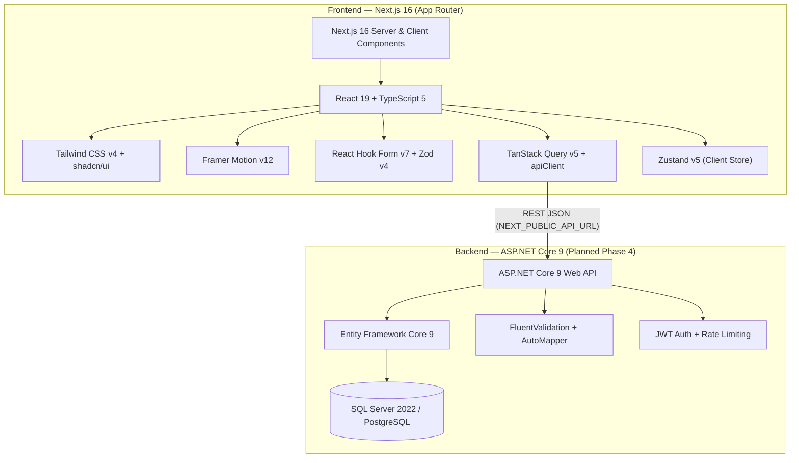

# 🏗️ System Architecture & Codebase Structure

Tài liệu mô tả kiến trúc hệ thống, công nghệ sử dụng, cấu trúc thư mục và luồng dữ liệu của dự án **Nha Khoa Thu Mảnh**.

---

## 1. Kiến Trúc Tổng Thể (High-Level Architecture)



---

## 2. Chi Tiết Tech Stack (Frontend)

| Nhóm | Thư viện | Phiên bản | Vai trò trong dự án |
|---|---|---|---|
| **Core** | `next`, `react`, `typescript` | `16.2.1`, `19.2.4`, `^5` | App Router, Server Components, SEO Metadata |
| **Styling** | `tailwindcss`, `tw-animate-css` | `^4`, `^1.4.0` | CSS-first configuration tại `src/app/globals.css` |
| **UI Components** | `shadcn`, `radix-ui`, `lucide-react` | `^4.1.0`, `^1.4.3`, `^1.0.1` | Hệ thống component chuẩn A11y (`Button`, `Card`, `Dialog`, `Select`, `Sheet`, `Input`...) |
| **Animations** | `framer-motion` | `^12.38.0` | Hiệu ứng xuất hiện khi cuộn trang và chuyển động tương tác |
| **Forms** | `react-hook-form`, `zod`, `@hookform/resolvers` | `^7.72.0`, `^4.3.6`, `^5.2.2` | Quản lý form Đặt lịch & Liên hệ kèm kiểm tra dữ liệu chặt chẽ |
| **Data & State** | `@tanstack/react-query`, `zustand` | `^5.95.2`, `^5.0.12` | Quản lý server state/caching và client state |
| **Carousel** | `embla-carousel-react` | `^8.6.0` | Slider cho đánh giá khách hàng / hình ảnh |

---

## 3. Cấu Trúc Thư Mục (`dental-clinic-web/`)

```text
dental-clinic-web/
├── AGENTS.md                        # Quy tắc vận hành cho AI Coding Agents
├── CLAUDE.md                        # Liên kết tới @AGENTS.md cho Claude Code
├── docs/                            # Tài liệu chi tiết dự án cho AI & Developers
│   ├── README.md                    # Tổng quan dự án, thông tin phòng khám & lộ trình
│   ├── ARCHITECTURE.md              # Kiến trúc hệ thống & cấu trúc mã nguồn
│   ├── DESIGN_SYSTEM.md             # Design tokens, màu sắc, typography & UI rules
│   └── API_SPEC.md                  # Đặc tả REST API & Database Schema cho Backend
├── public/
│   └── images/
│       └── clinic-interior.png      # Hình ảnh nội thất phòng khám
├── src/
│   ├── app/                         # Next.js 16 App Router
│   │   ├── globals.css              # Tailwind v4 + Brand tokens + shadcn/ui theme
│   │   ├── layout.tsx               # RootLayout (Header + main + Footer + SEO Metadata)
│   │   ├── page.tsx                 # Trang Chủ (/)
│   │   ├── not-found.tsx            # Trang 404 tùy chỉnh
│   │   ├── favicon.ico              # Multi-size ICO (16x16, 32x32, 48x48)
│   │   ├── icon.svg                 # Vector SVG tab icon
│   │   ├── apple-icon.png           # Apple Touch Icon (180x180)
│   │   ├── dich-vu/
│   │   │   └── page.tsx             # Trang Dịch Vụ (/dich-vu)
│   │   ├── gioi-thieu/
│   │   │   └── page.tsx             # Trang Giới Thiệu (/gioi-thieu)
│   │   ├── dat-lich/
│   │   │   └── page.tsx             # Trang Đặt Lịch (/dat-lich)
│   │   └── lien-he/
│   │       └── page.tsx             # Trang Liên Hệ (/lien-he)
│   ├── components/
│   │   ├── layout/                  # Header.tsx, Footer.tsx, FloatingContactButtons.tsx
│   │   ├── sections/                # Các section trên Trang Chủ & dùng chung (CTASection)
│   │   ├── pages/                   # Các section chuyên biệt cho từng trang con
│   │   │   ├── about/               # AboutHero, OurStory, CoreValues, DoctorProfile, Timeline, MissionVision, AboutStats
│   │   │   ├── services/            # ServicesHero, ServicesGrid, QualityCommitment, ServicesCTA
│   │   │   ├── booking/             # BookingHero, BookingFormSection
│   │   │   └── contact/             # ContactHero, ContactInfoCards, ContactFormMap
│   │   └── ui/                      # Các base components của shadcn/ui
│   ├── lib/
│   │   ├── api/
│   │   │   └── client.ts            # Fetch wrapper gọi tới ASP.NET Core API
│   │   ├── constants/
│   │   │   └── site.ts              # Single Source of Truth: siteConfig, navLinks, services, detailedServices, testimonials...
│   │   ├── providers/
│   │   │   └── QueryProvider.tsx    # TanStack QueryClientProvider
│   │   └── utils.ts                 # Hàm cn() gộp class Tailwind
│   └── types/
│       └── index.ts                 # TypeScript interfaces: Service, Appointment, ContactMessage, Testimonial
└── package.json
```

---

## 4. Bản Đồ Routes & Liên Kết Giữa Các Trang

| Route | File Entry | Các Components Chính | Ghi chú Luồng Nghiệp Vụ |
|---|---|---|---|
| `/` | `src/app/page.tsx` | `HeroSection`, `StatsSection`, `WhyChooseUsSection`, `ServicesSection`, `ProcessSection`, `TestimonialsSection`, `CTASection` | Hiển thị 4 dịch vụ nổi bật (`services`) và điều hướng sang `/dich-vu` hoặc `/dat-lich`. |
| `/dich-vu` | `src/app/dich-vu/page.tsx` | `ServicesHero`, `ServicesGrid`, `QualityCommitment`, `ServicesCTA` | Hiển thị đầy đủ 8 dịch vụ (`detailedServices`). Nút **"Đặt Lịch"** trên mỗi thẻ sẽ truyền query `?service=<id>` sang `/dat-lich`. |
| `/gioi-thieu` | `src/app/gioi-thieu/page.tsx` | `AboutHero`, `OurStory`, `CoreValues`, `DoctorProfile`, `Timeline`, `MissionVision`, `AboutStats`, `CTASection` | Giới thiệu lịch sử từ 2010, BS. Thu Mảnh, giá trị cốt lõi, sứ mệnh & tầm nhìn tại Đồng Nai. |
| `/dat-lich` | `src/app/dat-lich/page.tsx` | `BookingHero`, `BookingFormSection` | Đọc `useSearchParams().get("service")` (bọc trong `<Suspense>`) để tự động điền dịch vụ. Gửi `POST /appointments` qua `apiClient`. |
| `/lien-he` | `src/app/lien-he/page.tsx` | `ContactHero`, `ContactInfoCards`, `ContactFormMap`, `CTASection` | Hiển thị 4 thẻ thông tin, form gửi tin nhắn `POST /contacts`, và bản đồ Google Maps (`W3RG+CR2`). |
